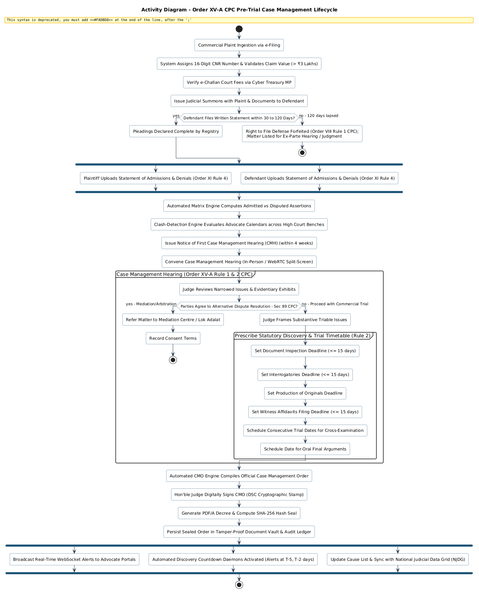

# Activity Diagram: Order XV-A CPC Pre-Trial Case Management Lifecycle

**Academic Framework:** Major Project (BTCS706N) - Semester VII  
**Institution:** Shri Vaishnav Vidyapeeth Vishwavidyalaya, Indore  
**Department:** Computer Science and Engineering  
**Team ID:** SVVV-CSE-2026-MP-14  
**Project Guide:** Prof. Shweta Pandey  

---

## 🖼️ Print-Ready Diagram Image

> [!TIP]
> **High-Resolution Vector SVG**: [Download Activity_Diagram.svg](file:///Users/mukulbhamgare/Desktop/case-management-eportal/diagrams/Activity_Diagram.svg)  
> **Print-Ready PNG Image**: [Download Activity_Diagram.png](file:///Users/mukulbhamgare/Desktop/case-management-eportal/diagrams/Activity_Diagram.png)  
> **Full Printable UML Book (HTML)**: [Open Printable_UML_Book.html](file:///Users/mukulbhamgare/Desktop/case-management-eportal/diagrams/Printable_UML_Book.html)

  

---

## 1. Visual Mermaid Activity Diagram

```mermaid
flowchart TD
    Start([Start: Ingestion of Commercial Plaint]) --> Ingest["Assign 16-Digit CNR Number & Verify Claim > ₹3,00,000"]
    Ingest --> FeeCheck["Verify Court Fees via MP Cyber Treasury API"]
    FeeCheck --> Summons["Issue Judicial Summons to Defendant with Plaint & Exhibits"]
    
    Summons --> DecWS{"Written Statement filed within 30–120 days?"}
    
    DecWS -- "No (120 Days Expired)" --> Forfeit["Defense Forfeited by Law\n(Order VIII Rule 1 CPC)"]
    Forfeit --> ExParte["List for Ex-Parte Evidence / Judgment"]
    ExParte --> EndForfeit([Case Disposed])
    
    DecWS -- "Yes (Within Limitation)" --> PleadingsDone["Pleadings Declared Complete by Registry"]
    
    PleadingsDone --> ForkAdmissions{"Parallel Admission Filing"}
    ForkAdmissions --> PlffAdmin["Plaintiff files Statement of Admissions & Denials (Order XI Rule 4)"]
    ForkAdmissions --> DefAdmin["Defendant files Statement of Admissions & Denials (Order XI Rule 4)"]
    
    PlffAdmin --> JoinAdmin{"Join Admissions"}
    DefAdmin --> JoinAdmin
    
    JoinAdmin --> AutoMatrix["Automated Matrix Engine Computes Admitted vs Disputed Assertions"]
    AutoMatrix --> ClashCheck["Clash Detection Engine Checks Advocate Cross-Bench Conflicts"]
    ClashCheck --> NoticeCMH["Issue Notice for First Case Management Hearing (within 4 weeks)"]
    
    NoticeCMH --> ConveneCMH["Convene CMH Session (Physical Bench or WebRTC Split-Screen)"]
    
    ConveneCMH --> ADRCheck{"Parties Agree to ADR? (Sec 89 CPC)"}
    ADRCheck -- "Yes" --> ADRReferral["Refer to Mediation / Lok Adalat & Record Consent Terms"]
    ADRReferral --> EndADR([Case Settled via ADR])
    
    ADRCheck -- "No" --> FrameIssues["Judge Reviews Admitted Facts & Frames Triable Issues"]
    
    FrameIssues --> Timetable["Prescribe Statutory Discovery & Trial Timetable (Order XV-A Rule 2)"]
    
    subgraph Timetable_Tasks ["Mandatory Order XV-A Rule 2 Timetable Fixation"]
        T1["Inspection of Documents (<= 15 Days)"]
        T2["Filing & Answering Interrogatories (<= 15 Days)"]
        T3["Filing Affidavits in Lieu of Examination-in-Chief (<= 15 Days)"]
        T4["Fix Consecutive Day-to-Day Trial Dates for Cross-Examination"]
        T5["Fix Final Oral Arguments Date"]
    end
    
    Timetable --> Timetable_Tasks
    Timetable_Tasks --> GenCMO["Automated CMO Engine Compiles Draft Order"]
    GenCMO --> JudgeSign["Hon'ble Judge Digitally Signs CMO (DSC Cryptographic Seal)"]
    JudgeSign --> HashVault["Generate PDF/A Decree with SHA-256 Hash in Secure Vault"]
    
    HashVault --> ForkNotify{"Parallel Actions"}
    ForkNotify --> WSNotify["Push WebSocket Alerts to Advocate & Litigant Dashboards"]
    ForkNotify --> DaemonStart["Activate Discovery Countdown Daemon (Alerts at T-5, T-2 Days)"]
    ForkNotify --> NJDGSync["Update High Court Cause List & Sync with CIS / NJDG"]
    
    WSNotify --> JoinNotify{"Join"}
    DaemonStart --> JoinNotify
    NJDGSync --> JoinNotify
    
    JoinNotify --> EndLifecycle([Pre-Trial Complete: Trial Commences on Fixed Schedule])
```

---

## 2. Activity Workflow & Legal Milestones

### 1. Ingestion, Valuation & Cyber Treasury Verification
- Every commercial suit filed in the Commercial Division of the High Court of Madhya Pradesh undergoes statutory valuation under the **Commercial Courts Act, 2015** (Specified Value threshold $\ge$ ₹3,00,000).
- Ad-valorem court fees are validated automatically against the **Madhya Pradesh Cyber Treasury Portal** using the Challan Reference Number (CRN).

### 2. Pleading Timelines & Non-Condoneable Default (Order VIII Rule 1 CPC)
- The workflow models the strict statutory timeline of 30 days (extendable up to an absolute maximum of 120 days) for filing the Written Statement.
- In compliance with landmark Supreme Court precedents (*SCG Contracts India Pvt. Ltd. v. K.S. Chamankar Infrastructure*), failure to file within 120 days triggers automated forfeiture of the defense right, preventing civil trial bottlenecks.

### 3. Parallel Statements of Admissions & Denials (Order XI Rule 4 CPC)
- Under the Commercial Courts Act amendments to the CPC, general denials are prohibited.
- The parallel activities enforce that both parties file itemized statements admitting, denying, or demanding proof with corresponding exhibit numbers, which the system compiles into a statistical admissions index.

### 4. Statutory Case Management Hearing (Order XV-A Rule 1 & Rule 2 CPC)
- The Presiding Judge holds the first CMH within four weeks of the completion of pleadings.
- If mediation is not elected under Section 89 of the CPC, the system guides the court to fix mandatory discovery deadlines:
  - Inspection of documents: $\le 15$ days
  - Interrogatories: $\le 15$ days
  - Evidence affidavits: $\le 15$ days
  - Continuous day-to-day cross-examination dates to prevent adjournments.

### 5. Cryptographic Sealing & Continuous Monitoring
- The final Case Management Order (CMO) is rendered tamper-proof with a **SHA-256 cryptographic hash seal** and **Judicial Digital Signature (DSC)**.
- Automated background daemons monitor all discovery countdowns, sending push notifications and SMS alerts before deadlines lapse.
