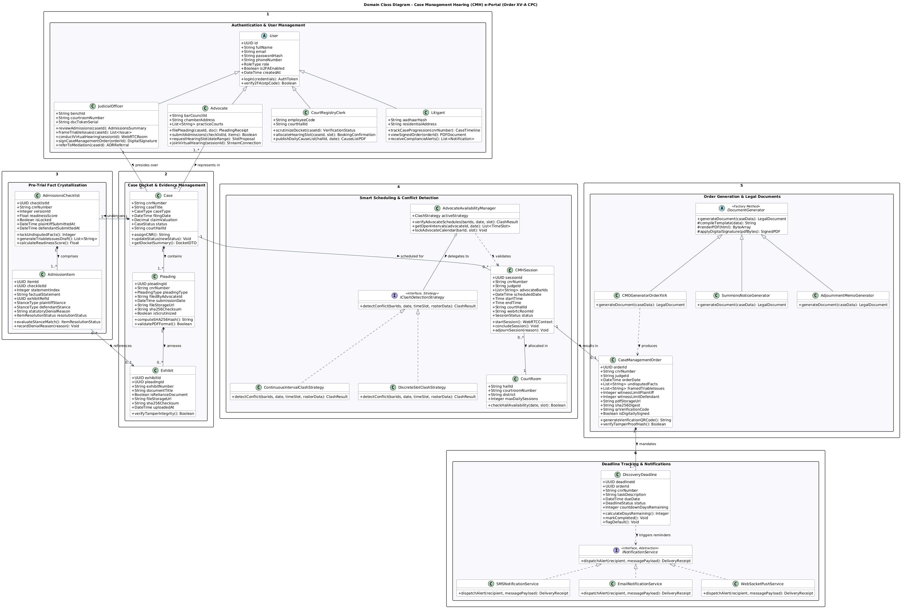

# Domain Class Diagram: e-Portal for Case Management Hearing (Order XV-A CPC)

**Academic Framework:** Major Project (BTCS706N)  
**Team ID:** SVVV-CSE-2026-MP-14  
**Project Guide:** Prof. Shweta Pandey  

---

## 🖼️ Print-Ready Diagram Image

> [!TIP]
> **High-Resolution Vector SVG**: [Download Class_Diagram.svg](file:///Users/mukulbhamgare/Desktop/case-management-eportal/diagrams/Class_Diagram.svg)  
> **Print-Ready PNG Image**: [Download Class_Diagram.png](file:///Users/mukulbhamgare/Desktop/case-management-eportal/diagrams/Class_Diagram.png)  
> **Full Printable UML Book (HTML)**: [Open Printable_UML_Book.html](file:///Users/mukulbhamgare/Desktop/case-management-eportal/diagrams/Printable_UML_Book.html)

  

---

## 1. Mermaid Visual Class Diagram

```mermaid
classDiagram
    direction TB

    %% ==========================================
    %% 1. USER & RBAC HIERARCHY
    %% ==========================================
    class User {
        <<abstract>>
        +UUID id
        +String fullName
        +String email
        +String passwordHash
        +String phoneNumber
        +RoleType role
        +Boolean is2FAEnabled
        +DateTime createdAt
        +login(credentials) AuthToken
        +verify2FA(otpCode) Boolean
    }

    class JudicialOfficer {
        +String benchId
        +String courtroomNumber
        +String dscTokenSerial
        +reviewAdmissions(caseId) AdmissionsSummary
        +frameTriableIssues(caseId) List~Issue~
        +conductVirtualHearing(sessionId) WebRTCRoom
        +signCaseManagementOrder(orderId) DigitalSignature
        +referToMediation(caseId) ADRReferral
    }

    class Advocate {
        +String barCouncilId
        +String chamberAddress
        +List~String~ practiceCourts
        +filePleading(caseId, doc) PleadingReceipt
        +submitAdmissions(checklistId, items) Boolean
        +requestHearingSlot(dateRange) SlotProposal
        +joinVirtualHearing(sessionId) StreamConnection
    }

    class CourtRegistryClerk {
        +String employeeCode
        +String courtHallId
        +scrutinizeDocket(caseId) VerificationStatus
        +allocateHearingSlot(caseId, slot) BookingConfirmation
        +publishDailyCauseList(hallId, date) CauseListPDF
    }

    class Litigant {
        +String aadhaarHash
        +String residentialAddress
        +trackCaseProgression(cnrNumber) CaseTimeline
        +viewSignedOrder(orderId) PDFDocument
        +receiveComplianceAlerts() List~Notification~
    }

    User <|-- JudicialOfficer : Generalization
    User <|-- Advocate : Generalization
    User <|-- CourtRegistryClerk : Generalization
    User <|-- Litigant : Generalization

    %% ==========================================
    %% 2. CASE DOCKET & EVIDENCE
    %% ==========================================
    class Case {
        +String cnrNumber
        +String caseTitle
        +CaseType caseType
        +DateTime filingDate
        +Decimal claimValuation
        +CaseStatus status
        +String courtHallId
        +assignCNR() String
        +updateStatus(newStatus) Void
        +getDocketSummary() DocketDTO
    }

    class Pleading {
        +UUID pleadingId
        +String cnrNumber
        +PleadingType pleadingType
        +String filedByAdvocateId
        +DateTime submissionDate
        +String fileStorageUrl
        +String sha256Checksum
        +Boolean isScrutinized
        +computeSHA256Hash() String
        +validatePDFFormat() Boolean
    }

    class Exhibit {
        +UUID exhibitId
        +UUID pleadingId
        +String exhibitNumber
        +String documentTitle
        +Boolean isRelianceDocument
        +String fileStorageUrl
        +String sha256Checksum
        +DateTime uploadedAt
        +verifyTamperIntegrity() Boolean
    }

    Case "1" *-- "1..*" Pleading : contains
    Pleading "1" *-- "0..*" Exhibit : annexes
    Advocate "1..*" -- "0..*" Case : represents in
    JudicialOfficer "1" -- "0..*" Case : presides over

    %% ==========================================
    %% 3. ADMISSIONS & DENIALS (ORDER XV-A)
    %% ==========================================
    class AdmissionsChecklist {
        +UUID checklistId
        +String cnrNumber
        +Integer versionId
        +Float readinessScore
        +Boolean isLocked
        +DateTime plaintiffSubmittedAt
        +DateTime defendantSubmittedAt
        +lockUndisputedFacts() Integer
        +generateTriableIssuesDraft() List~String~
        +calculateReadinessScore() Float
    }

    class AdmissionItem {
        +UUID itemId
        +UUID checklistId
        +Integer statementIndex
        +String factualStatement
        +UUID exhibitRefId
        +StanceType plaintiffStance
        +StanceType defendantStance
        +String statutoryDenialReason
        +ItemResolutionStatus resolutionStatus
        +evaluateStanceMatch() ItemResolutionStatus
        +recordDenialReason(reason) Void
    }

    Case "1" *-- "1" AdmissionsChecklist : undergoes
    AdmissionsChecklist "1" *-- "1..*" AdmissionItem : comprises
    AdmissionItem "0..*" --> "0..1" Exhibit : references

    %% ==========================================
    %% 4. SCHEDULING & STRATEGY PATTERN
    %% ==========================================
    class CMHSession {
        +UUID sessionId
        +String cnrNumber
        +String judgeId
        +List~String~ advocateBarIds
        +DateTime scheduledDate
        +Time startTime
        +Time endTime
        +String courtHallId
        +String webrtcRoomId
        +SessionStatus status
        +startSession() WebRTCContext
        +concludeSession() Void
        +adjournSession(reason) Void
    }

    class CourtRoom {
        +String hallId
        +String courtroomNumber
        +String district
        +Integer maxDailySessions
        +checkHallAvailability(date, slot) Boolean
    }

    class AdvocateAvailabilityManager {
        +verifyAdvocateSchedules(barIds, date, slot) ClashResult
        +getOpenIntervals(advocateId, date) List~TimeSlot~
        +lockAdvocateCalendar(barId, slot) Void
    }

    class IClashDetectionStrategy {
        <<interface>>
        +detectConflict(barIds, date, timeSlot, rosterData)* ClashResult
    }

    class DiscreteSlotClashStrategy {
        +detectConflict(barIds, date, timeSlot, rosterData) ClashResult
    }

    class ContinuousIntervalClashStrategy {
        +detectConflict(barIds, date, timeSlot, rosterData) ClashResult
    }

    IClashDetectionStrategy <|.. DiscreteSlotClashStrategy : Implements
    IClashDetectionStrategy <|.. ContinuousIntervalClashStrategy : Implements
    AdvocateAvailabilityManager o-- IClashDetectionStrategy : Strategy Context
    CMHSession "0..*" -- "1" CourtRoom : allocated in
    Case "1" -- "0..*" CMHSession : scheduled for
    AdvocateAvailabilityManager ..> CMHSession : validates

    %% ==========================================
    %% 5. ORDER GENERATION (FACTORY METHOD)
    %% ==========================================
    class CaseManagementOrder {
        +UUID orderId
        +String cnrNumber
        +String judgeId
        +DateTime orderDate
        +List~String~ undisputedFacts
        +List~String~ framedTriableIssues
        +Integer witnessLimitPlaintiff
        +Integer witnessLimitDefendant
        +String pdfStorageUrl
        +String sha256Digest
        +String qrVerificationCode
        +Boolean isDigitallySigned
        +generateVerificationQRCode() String
        +verifyTamperProofHash() Boolean
    }

    class DocumentGenerator {
        <<abstract>>
        +generateDocument(caseData)* LegalDocument
        #compileTemplate(data) String
        #renderPDF(html) ByteArray
        #applyDigitalSignature(pdfBytes) SignedPDF
    }

    class CMOGeneratorOrderXVA {
        +generateDocument(caseData) LegalDocument
    }

    class SummonsNoticeGenerator {
        +generateDocument(caseData) LegalDocument
    }

    class AdjournmentMemoGenerator {
        +generateDocument(caseData) LegalDocument
    }

    DocumentGenerator <|-- CMOGeneratorOrderXVA
    DocumentGenerator <|-- SummonsNoticeGenerator
    DocumentGenerator <|-- AdjournmentMemoGenerator
    CMHSession "1" -- "0..1" CaseManagementOrder : results in
    CMOGeneratorOrderXVA ..> CaseManagementOrder : instantiates

    %% ==========================================
    %% 6. COMPLIANCE & NOTIFICATIONS
    %% ==========================================
    class DiscoveryDeadline {
        +UUID deadlineId
        +UUID orderId
        +String cnrNumber
        +String taskDescription
        +DateTime dueDate
        +DeadlineStatus status
        +Integer countdownDaysRemaining
        +calculateDaysRemaining() Integer
        +markCompleted() Void
        +flagDefault() Void
    }

    class INotificationService {
        <<interface>>
        +dispatchAlert(recipient, messagePayload)* DeliveryReceipt
    }

    class SMSNotificationService {
        +dispatchAlert(recipient, messagePayload) DeliveryReceipt
    }

    class EmailNotificationService {
        +dispatchAlert(recipient, messagePayload) DeliveryReceipt
    }

    class WebSocketPushService {
        +dispatchAlert(recipient, messagePayload) DeliveryReceipt
    }

    INotificationService <|.. SMSNotificationService : Implements
    INotificationService <|.. EmailNotificationService : Implements
    INotificationService <|.. WebSocketPushService : Implements
    CaseManagementOrder "1" *-- "1..*" DiscoveryDeadline : mandates
    DiscoveryDeadline ..> INotificationService : triggers
```

---

## 2. Key Object-Oriented Principles & Design Patterns

### A. Actor Generalization & Specialization (Inheritance)
* **Base Class:** `User` handles common authentication, JWT token issuance, bcrypt hashed passwords, and 2FA verification.
* **Specialized Subclasses:** `JudicialOfficer`, `Advocate`, `CourtRegistryClerk`, and `Litigant` extend `User` with role-specific attributes (e.g., `dscTokenSerial`, `barCouncilId`) and operations enforcing Role-Based Access Control (RBAC).

### B. Strategy Design Pattern (`ClashDetectionEngine`)
* **Context:** `AdvocateAvailabilityManager`
* **Strategy Interface:** `IClashDetectionStrategy`
* **Concrete Strategies:**
  1. `DiscreteSlotClashStrategy`: Validates discrete 20-minute time slices across court complexes.
  2. `CalendarIntervalClashStrategy`: Evaluates continuous interval overlaps for complex multi-bench matters.
* **Benefit:** Decouples collision algorithms from courtroom allocation logic, allowing runtime algorithm switching without breaking the scheduling API.

### C. Factory Method Pattern (`DocumentGenerator`)
* **Creator:** `DocumentGenerator` (Abstract Factory Method)
* **Concrete Products / Creators:**
  1. `CMOGeneratorOrderXVA`: Compiles Order XV-A Case Management Orders with undisputed facts, framed issues, and witness quotas.
  2. `SummonsNoticeGenerator`: Generates electronic summons notices.
  3. `AdjournmentMemoGenerator`: Issues formal adjournment memos with statutory penalty tracking.

### D. Interface Abstraction (`NotificationService`)
* **Abstract Interface:** `INotificationService`
* **Implementations:** `SMSNotificationService` (NIC/Twilio), `EmailNotificationService` (SMTP/SES), and `WebSocketPushService` (real-time in-browser alerts).
* **Benefit:** Loose coupling ensures the notification dispatcher can trigger alerts over any communication channel without modifying business logic.

---

## 3. Entity Multiplicities & Cardinalities

| Relationship | Multiplicity | Type | Rationale |
| :--- | :---: | :---: | :--- |
| `Case` to `Pleading` | `1` to `1..*` | Composition (`*--`) | A case docket must have at least one plaint and written statement. Pleadings cannot exist without their parent case. |
| `Pleading` to `Exhibit` | `1` to `0..*` | Composition (`*--`) | Pleadings may include zero or many reliance evidence annexures. |
| `Case` to `AdmissionsChecklist` | `1` to `1` | Composition (`*--`) | Under Order XV-A, each registered case possesses exactly one active Admissions & Denials state machine. |
| `AdmissionsChecklist` to `AdmissionItem` | `1` to `1..*` | Composition (`*--`) | A checklist is composed of itemized averments and document verification lines. |
| `AdmissionItem` to `Exhibit` | `0..*` to `0..1` | Association (`-->`) | An item in the matrix directly references the exhibit document being admitted or denied. |
| `Advocate` to `Case` | `1..*` to `0..*` | Association (`--`) | Multiple advocates can represent parties in multiple cases (Many-to-Many). |
| `JudicialOfficer` to `Case` | `1` to `0..*` | Association (`--`) | A judge presides over multiple cases within their court hall. |
| `Case` to `CMHSession` | `1` to `0..*` | Aggregation (`--`) | A case may undergo one or more pre-trial hearing sessions (if adjourned). |
| `CourtRoom` to `CMHSession` | `1` to `0..*` | Association (`--`) | A physical or virtual courtroom hall hosts scheduled hearing sessions. |
| `CMHSession` to `CaseManagementOrder` | `1` to `0..1` | Association (`--`) | A concluded CMH conference produces exactly one Case Management Order. |
| `CaseManagementOrder` to `DiscoveryDeadline` | `1` to `1..*` | Composition (`*--`) | A binding CMO fixes mandatory statutory discovery deadlines for both parties. |
