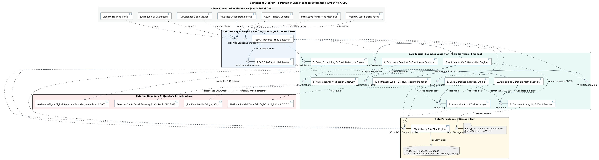

# Component Diagram: e-Portal for Case Management Hearing (Order XV-A CPC)

**Academic Framework:** Major Project (BTCS706N)  
**Team ID:** SVVV-CSE-2026-MP-14  
**Project Guide:** Prof. Shweta Pandey  

---

## 🖼️ Print-Ready Diagram Image

> [!TIP]
> **High-Resolution Vector SVG**: [Download Component_Diagram.svg](file:///Users/mukulbhamgare/Desktop/case-management-eportal/diagrams/Component_Diagram.svg)  
> **Print-Ready PNG Image**: [Download Component_Diagram.png](file:///Users/mukulbhamgare/Desktop/case-management-eportal/diagrams/Component_Diagram.png)  
> **Full Printable UML Book (HTML)**: [Open Printable_UML_Book.html](file:///Users/mukulbhamgare/Desktop/case-management-eportal/diagrams/Printable_UML_Book.html)

  

---

## 1. Visual Mermaid Component Diagram

```mermaid
graph TB
    %% ==========================================
    %% TIER 1: CLIENT PRESENTATION TIER
    %% ==========================================
    subgraph Presentation_Tier ["1. Client Presentation Tier (React.js + Tailwind CSS + FullCalendar)"]
        UI_Judge["[Judge Judicial Dashboard]"]
        UI_Advocate["[Advocate Collaborative Portal]"]
        UI_Clerk["[Court Registry Console]"]
        UI_Litigant["[Litigant Public Portal]"]
        
        UI_Matrix["[Interactive Admissions Matrix UI]"]
        UI_Calendar["[FullCalendar Clash Viewer]"]
        UI_WebRTC["[WebRTC Split-Screen Room]"]
    end

    %% ==========================================
    %% TIER 2: API GATEWAY & SECURITY
    %% ==========================================
    subgraph Gateway_Tier ["2. API Gateway & Security Tier (FastAPI Asynchronous ASGI)"]
        GW_Router["[FastAPI Reverse Proxy & Router]"]
        GW_Auth["[RBAC & JWT Auth Middleware]"]
    end

    %% ==========================================
    %% TIER 3: CORE 9 SYSTEM MODULES
    %% ==========================================
    subgraph Business_Tier ["3. Core Judicial Business Logic Tier (9 Decoupled Modules)"]
        M1["1. Case & Docket Ingestion Engine"]
        M2["2. Admissions & Denials Matrix Service"]
        M3["3. Smart Scheduling & Clash Detection Engine"]
        M4["4. WebRTC Virtual Courtroom Manager"]
        M5["5. Automated CMO Generation Engine"]
        M6["6. Discovery Deadline Countdown Daemon"]
        M7["7. Document Integrity & Vault Service"]
        M8["8. Multi-Channel Notification Gateway"]
        M9["9. Immutable Audit Trail & Ledger"]
    end

    %% ==========================================
    %% TIER 4: DATA PERSISTENCE & STORAGE
    %% ==========================================
    subgraph Storage_Tier ["4. Persistence & Storage Tier"]
        DB_ORM["[SQLAlchemy 2.0 ORM Engine]"]
        DB_MySQL[("MySQL 8.0 Relational DB\n(Users, Dockets, Admissions, Orders)")]
        Storage_Blob[("Encrypted Document Vault\n(PDF/A Records & Exhibits)")]
    end

    %% ==========================================
    %% TIER 5: EXTERNAL STATUTORY INFRASTRUCTURE
    %% ==========================================
    subgraph External_Tier ["5. External Statutory Infrastructure & APIs"]
        Ext_NJDG["[NJDG / High Court CIS 3.2 APIs]"]
        Ext_Telecom["[SMS / Email Gateways (NIC/Twilio)]"]
        Ext_eSign["[Digital Signature / DSC (e-Mudhra / CDAC)]"]
        Ext_Jitsi["[Jitsi Meet Media Bridge (SFU)]"]
    end

    %% UI to Gateway connections
    UI_Judge -->|REST / HTTPS| GW_Router
    UI_Advocate -->|REST / HTTPS| GW_Router
    UI_Clerk -->|REST / HTTPS| GW_Router
    UI_Litigant -->|REST / HTTPS| GW_Router
    UI_Matrix -->|WebSocket Sync| GW_Router
    UI_Calendar -->|REST / JSON| GW_Router
    UI_WebRTC -->|WebSockets Signaling| GW_Router

    %% Gateway to Security
    GW_Router <-->|Token Validation| GW_Auth

    %% Gateway Routing to Core Engines
    GW_Router --> M1
    GW_Router --> M2
    GW_Router --> M3
    GW_Router --> M4
    GW_Router --> M5

    %% Inter-Module Dependencies
    M1 -->|Hash & Validate PDF/A| M7
    M1 -->|Log Case Filing| M9
    M2 -->|Verify Exhibit Hashes| M7
    M2 -->|Audit Lock Event| M9
    M3 -->|Check Advocate Roster| DB_ORM
    M4 -->|Log Attendance & Duration| M9
    M4 -.->|Signaling / Streams| Ext_Jitsi
    M5 -->|Fetch Undisputed Facts| M2
    M5 -->|Archive Signed Order| M7
    M5 -->|Trigger Dispatch| M8
    M6 -->|Periodic Trigger| M8
    M7 -->|Store Blobs| Storage_Blob

    %% Engines to Database Tier
    M1 --> DB_ORM
    M2 --> DB_ORM
    M3 --> DB_ORM
    M5 --> DB_ORM
    M6 --> DB_ORM
    M9 --> DB_ORM
    DB_ORM --> DB_MySQL

    %% External Connections
    M1 -.->|Sync CNR| Ext_NJDG
    M5 -.->|Verify DSC Token| Ext_eSign
    M8 -.->|Dispatch Alerts| Ext_Telecom
```

---

## 2. Exhaustive Description of the 9 Decoupled Modules

### Module 1: Case & Docket Ingestion Engine
* **Purpose:** Handles end-to-end electronic filing of civil/commercial suits under Order XV-A CPC.
* **Provided Interface:** `IDocketIngest` (`create_case()`, `upload_pleading()`, `assign_cnr()`, `get_docket()`)
* **Responsibilities:**
  * Generates 16-digit Unique Case Record (CNR) numbers compatible with e-Courts format.
  * Ingests electronic plaints, written statements, and reliance exhibits.
  * Delegates SHA-256 calculation to Module 7 and registers the case in `PENDING_CMH_PREPARATION` status.

### Module 2: Admissions & Denials Matrix Service
* **Purpose:** Provides the pre-trial collaborative fact-narrowing workspace mandated by Order XV-A Rule 2.
* **Provided Interface:** `IAdmissionsMatrix` (`record_stance()`, `lock_undisputed_facts()`, `get_contested_issues()`)
* **Responsibilities:**
  * Maintains an itemized digital checklist of averments and reliance documents.
  * Captures opposing legal counsels' evidentiary stances (`ADMIT_EXECUTION`, `ADMIT_CONTENTS`, `DENY`).
  * Enforces database-level row-versioning (`version_id`) to prevent optimistic locking race conditions.
  * Locks mutually admitted facts as permanent, undisputed evidence and isolates contested items for trial.

### Module 3: Smart Scheduling & Clash Detection Engine
* **Purpose:** Eliminates cross-courtroom advocate double-booking—the primary driver of procedural adjournments.
* **Provided Interface:** `IScheduleClash` (`detect_conflict()`, `reserve_slot()`, `get_open_intervals()`)
* **Responsibilities:**
  * Implements the **Strategy Pattern** (`DiscreteSlotClashStrategy` and `ContinuousIntervalClashStrategy`).
  * Cross-examines advocate Bar Council IDs against daily cause lists across all district court halls.
  * Reserves conflict-free 20-minute CMH hearing slots with atomic ACID transaction locks.

### Module 4: In-Browser WebRTC Virtual Courtroom Manager
* **Purpose:** Facilitates remote, zero-install judicial pre-trial conferences.
* **Provided Interface:** `IWebRTCSignaling` (`init_room()`, `connect_peer()`, `stream_exhibit()`)
* **Responsibilities:**
  * Integrates Jitsi Meet / WebRTC Selective Forwarding Unit (SFU) in-browser.
  * Renders a split-screen workspace: left panel for video streams; right panel for live case dockets and admissions checklists.
  * Allows one-click referral to Alternative Dispute Resolution (ADR / Lok Adalat under Section 89 CPC).

### Module 5: Automated Case Management Order (CMO) Generation Engine
* **Purpose:** Automates the drafting, compilation, and cryptographic signing of enforceable Case Management Orders.
* **Provided Interface:** `ICMOGenerator` (`generate_cmo()`, `apply_digital_signature()`, `render_pdf()`)
* **Responsibilities:**
  * Uses the **Factory Method Pattern** to compile Order XV-A templates into PDF/A format via Jinja2 & WeasyPrint.
  * Aggregates settled facts, framed issues, witness limits, and discovery dates in under 5 seconds.
  * Interfaces with USB Token / DSC (e-Mudhra / CDAC) to apply legal digital signatures and embeds a QR code for verification.

### Module 6: Discovery Deadline & Countdown Daemon
* **Purpose:** Enforces strict compliance with the pre-trial discovery timetable set by the Judge.
* **Provided Interface:** `IDeadlineDaemon` (`evaluate_deadlines()`, `calculate_countdown()`, `flag_default()`)
* **Responsibilities:**
  * Executes a background cron process every hour to evaluate `discovery_deadlines`.
  * Monitors critical statutory milestones (e.g., 15 days for inspection of documents, 15 days for witness affidavits).
  * Automatically flags overdue matters for judicial penalty review under Order XV-A Rule 3(3).

### Module 7: Document Integrity & Vault Service
* **Purpose:** Guarantees cryptographic immutability and non-repudiation of all judicial exhibits and dockets.
* **Provided Interface:** `IDocVault` (`compute_sha256()`, `verify_checksum()`, `archive_document()`)
* **Responsibilities:**
  * Validates strict PDF/A compliance and scans incoming files for malware.
  * Calculates 64-character SHA-256 cryptographic digests immediately upon document ingestion.
  * Stores binary files in encrypted blob storage and writes hash receipts to the immutable database log.

### Module 8: Multi-Channel Notification Gateway
* **Purpose:** Dispatches automated statutory summons, calendar invitations, and deadline alerts.
* **Provided Interface:** `INotification` (`dispatch_sms()`, `dispatch_email()`, `push_websocket()`)
* **Responsibilities:**
  * Implements **Interface Abstraction** (`SMSNotificationService`, `EmailNotificationService`, `WebSocketPushService`).
  * Dispatches automated alerts at `T-7`, `T-3`, and `T-1` days before discovery deadlines.
  * Generates and attaches standard `.ics` calendar sync files to confirmation emails for advocates.

### Module 9: Immutable Audit Trail & Ledger
* **Purpose:** Provides forensic accountability and judicial tamper-evidence for all portal activities.
* **Provided Interface:** `IAuditLog` (`record_event()`, `query_history()`, `export_audit_certificate()`)
* **Responsibilities:**
  * Logs all actor activities with UTC timestamps, user IDs, IP addresses, and previous/updated states.
  * Records virtual hearing attendance, admission locking events, and order downloads into append-only tables.

---

## 3. Communication Protocols & Inter-Tier Coupling

| Connection | Protocol / Mechanism | Data Format | Latency Target |
| :--- | :--- | :--- | :--- |
| Client UI $\rightarrow$ API Gateway | HTTPS (TLS 1.3) / REST | JSON / Multipart Form | $< 200\text{ ms}$ |
| Matrix UI $\leftrightarrow$ Gateway | WebSockets (`ws://`, `wss://`) | JSON delta payloads | $< 50\text{ ms}$ |
| Video Stream $\leftrightarrow$ SFU | WebRTC (SRTP / DTLS) | H.264 / Opus streams | $< 100\text{ ms}$ |
| Gateway $\rightarrow$ Business Engines | In-process Asynchronous Python (`async/await`) | Python Pydantic Models | $< 5\text{ ms}$ |
| Business Engines $\rightarrow$ MySQL | TCP Connection Pool (SQLAlchemy 2.0) | Relational SQL + Native JSON | $< 15\text{ ms}$ |
| CMO Engine $\rightarrow$ eSign API | HTTPS REST (Mutual TLS) | PKCS#7 / XML signatures | $< 1500\text{ ms}$ |
| Notification $\rightarrow$ SMS Gateway | HTTPS POST | JSON / URL-encoded | $< 500\text{ ms}$ |
