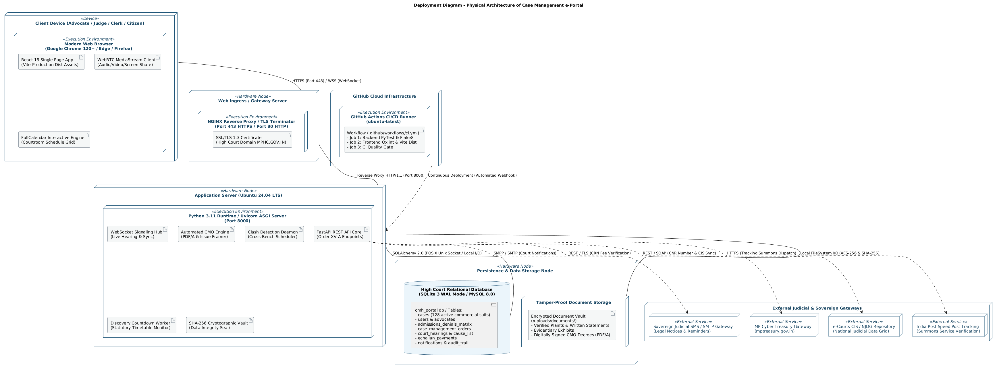
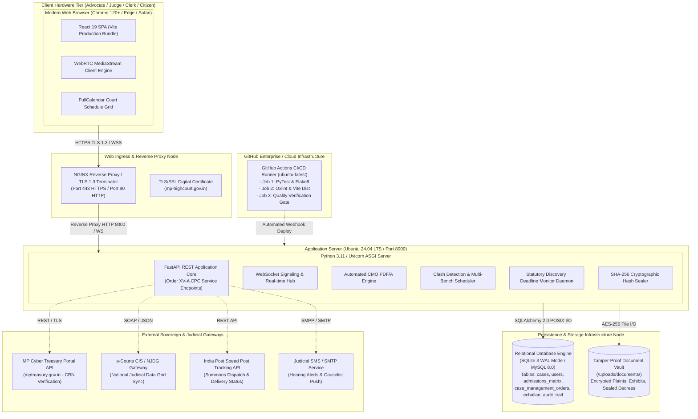

# Deployment Diagram: Case Management e-Portal Architecture

**Academic Framework:** Major Project (BTCS706N) - Semester VII  
**Institution:** Shri Vaishnav Vidyapeeth Vishwavidyalaya, Indore  
**Department:** Computer Science and Engineering  
**Team ID:** SVVV-CSE-2026-MP-14  
**Project Guide:** Prof. Shweta Pandey  

---

## 🖼️ Print-Ready Diagram Image

> [!TIP]
> **High-Resolution Vector SVG**: [Download Deployment_Diagram.svg](file:///Users/mukulbhamgare/Desktop/case-management-eportal/diagrams/Deployment_Diagram.svg)  
> **Print-Ready PNG Image**: [Download Deployment_Diagram.png](file:///Users/mukulbhamgare/Desktop/case-management-eportal/diagrams/Deployment_Diagram.png)  
> **Full Printable UML Book (HTML)**: [Open Printable_UML_Book.html](file:///Users/mukulbhamgare/Desktop/case-management-eportal/diagrams/Printable_UML_Book.html)

  

---

## 1. Visual Mermaid Deployment Diagram

---

## 2. Infrastructure & Node Deployment Details

### Node 1: Client Hardware & Execution Environment
- **Hardware Profile:** Commercial Litigant PCs, Judge Laptops, Mobile Devices.
- **Client Execution:** Browser runtime executing React 19 SPA, Tailwind CSS utilities, WebRTC `RTCPeerConnection` for virtual courtroom hearing rooms, and WebSocket clients for live court board updates.

### Node 2: Web Ingress & TLS Termination Node
- **Operating Environment:** NGINX 1.24+ reverse proxy.
- **Security Protocols:** TLS 1.3 with strict `HSTS` headers, rate limiting (100 req/sec per IP to prevent DoS on filing windows), and CORS lockdown restricted to authorized judicial subdomains.

### Node 3: Asynchronous Application Server Node
- **Operating System:** Ubuntu 24.04 LTS (x86_64 / ARM64).
- **Runtime Environment:** Python 3.11 with `uvloop` high-throughput event loop and Uvicorn multi-worker ASGI server.
- **Core Micro-Engines:**
  - Automated CMO Generator with ReportLab / PDF/A compliant generation.
  - Multi-Bench Clash Detection Engine querying overlapping court appearances across Indore, Jabalpur, and Gwalior benches.
  - Discovery Deadline Daemon calculating statutory 15-day limits per Order XV-A Rule 3.

### Node 4: Persistence & Storage Tier
- **Database Architecture:** Relational DB with foreign key constraints, indexed on CNR Number, Case Number, Hearing Date, and Advocate Bar Registration Number.
- **Cryptographic Document Vault:** File system directory `/uploads/documents/` maintaining SHA-256 integrity checksums for every uploaded plaint, written statement, and evidentiary exhibit.

### Node 5: External Sovereign Infrastructure
- **MP Cyber Treasury (`mptreasury.gov.in`):** Real-time verification of Challan Reference Numbers (CRN) for commercial court fee compliance.
- **e-Courts CIS & NJDG:** Bi-directional sync with Case Information System (CIS 3.2).
- **India Post Speed Post Service:** Tracks physical summons delivery to ensure strict compliance with Order V Rule 9 CPC.
