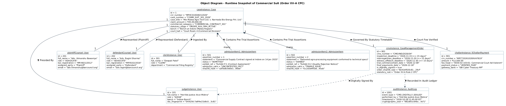
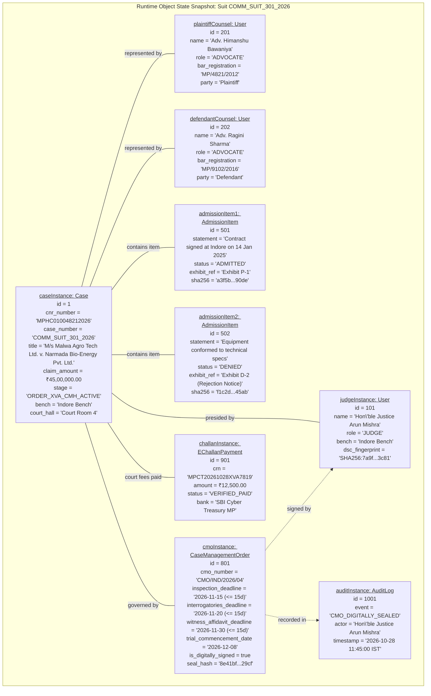

# Object Diagram: Runtime Instance Snapshot (Order XV-A CPC)

**Academic Framework:** Major Project (BTCS706N) - Semester VII  
**Institution:** Shri Vaishnav Vidyapeeth Vishwavidyalaya, Indore  
**Department:** Computer Science and Engineering  
**Team ID:** SVVV-CSE-2026-MP-14  
**Project Guide:** Prof. Shweta Pandey  

---

## 🖼️ Print-Ready Diagram Image

> [!TIP]
> **High-Resolution Vector SVG**: [Download Object_Diagram.svg](file:///Users/mukulbhamgare/Desktop/case-management-eportal/diagrams/Object_Diagram.svg)  
> **Print-Ready PNG Image**: [Download Object_Diagram.png](file:///Users/mukulbhamgare/Desktop/case-management-eportal/diagrams/Object_Diagram.png)  
> **Full Printable UML Book (HTML)**: [Open Printable_UML_Book.html](file:///Users/mukulbhamgare/Desktop/case-management-eportal/diagrams/Printable_UML_Book.html)

  

---

## 1. Visual Mermaid Object Diagram

---

## 2. Object State Analysis & Runtime Snapshot Interpretation

### 1. Concrete Case Snapshot
- The diagram models a live commercial dispute in the **High Court of Madhya Pradesh (Bench at Indore)**:
  - **Parties:** M/s Malwa Agro Tech Industries Ltd. (Plaintiff) vs Narmada Bio-Energy Equipments Pvt. Ltd. (Defendant).
  - **Claim Valuation:** ₹45,00,000 (Commercial dispute exceeding the Specified Value threshold of ₹3 Lakhs under Section 2(1)(i) of the Commercial Courts Act, 2015).
  - **Unique Judicial Identifiers:** 16-digit CNR Number `MPHC010048212026` linked with Court Room 4.

### 2. Multi-Actor Object Collaboration
- `JudgeObj` (`Hon'ble Justice Arun Mishra`): Holds judicial DSC cryptographic credentials to execute binding decrees.
- `AdvPlffObj` (`Adv. Himanshu Bawaniya`) and `AdvDefObj` (`Adv. Ragini Sharma`): Verified Bar Council practitioners registered with active roles.

### 3. Admission vs. Triable Issue Contrast
- `admissionItem1`: The commercial contract execution is marked **`ADMITTED`** with reference to Exhibit P-1. As an uncontested fact, no evidence will be recorded on this at trial, saving court time.
- `admissionItem2`: The conformity of goods to technical specifications is marked **`DENIED`** with reference to Exhibit D-2. This is formulated into a substantive triable issue in the Case Management Order.

### 4. Statutory Timetable Object (`cmoInstance`)
- Reflects the non-negotiable statutory timelines fixed under Order XV-A Rule 2 CPC:
  - Document Inspection: Within 15 days (`2026-11-15`)
  - Interrogatories: Within 15 days (`2026-11-20`)
  - Evidence Affidavits: Within 15 days (`2026-11-30`)
  - Continuous Cross-Examination Trial: Commencing `2026-12-08`
- Sealed with SHA-256 hash `8e41bf920c81...29cf` and cross-referenced in `auditInstance`.
