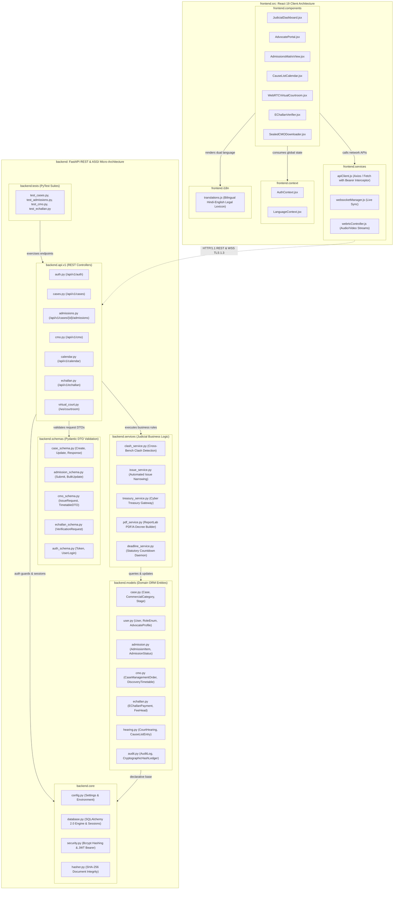

# Package Diagram: Modular Architecture of Case Management e-Portal

**Academic Framework:** Major Project (BTCS706N) - Semester VII  
**Institution:** Shri Vaishnav Vidyapeeth Vishwavidyalaya, Indore  
**Department:** Computer Science and Engineering  
**Team ID:** SVVV-CSE-2026-MP-14  
**Project Guide:** Prof. Shweta Pandey  

---

## 1. Visual Mermaid Package Diagram

---

## 2. Package Separation & Architectural Principles

### 1. High Cohesion & Loose Coupling
- The system strictly adheres to the **Layered Architecture pattern** and **Dependency Inversion Principle (DIP)**:
  - Route controllers (`backend.api.v1`) contain zero database queries; they delegate validation to `backend.schemas` and business logic to `backend.services`.
  - Database access is isolated within `backend.models` via SQLAlchemy 2.0 ORM mappers.

### 2. Statutory Legal Separation of Concerns
- The `AdmissionsMatrixModel` is kept cleanly segregated from the `CaseManagementOrderModel`.
- While admissions (Order XI Rule 4 CPC) are collaboratively contributed by opposing advocates, the Case Management Order (Order XV-A Rule 2 CPC) can only be generated and sealed through the judicial role authorization guard (`JudgeAuthGuard`).

### 3. Asynchronous Daemon Decoupling
- The `deadline_service.py` runs as an asynchronous background worker independent of the HTTP request-response cycle, continuously tracking statutory discovery expiry dates and firing WebSocket and email events when compliance windows near termination.

### 4. Client-Side Component Modularity
- The React 19 frontend organizes components by judicial user journeys:
  - `JudicialDashboard`: Dedicated to judicial officer docket control, admissions review, and digital signing.
  - `AdvocatePortal`: Focused on admission/denial uploads, exhibit referencing, and e-Challan fee tracking.
  - `WebRTCVirtualCourtroom`: Encapsulates WebRTC media stream handling and split-screen video display.
