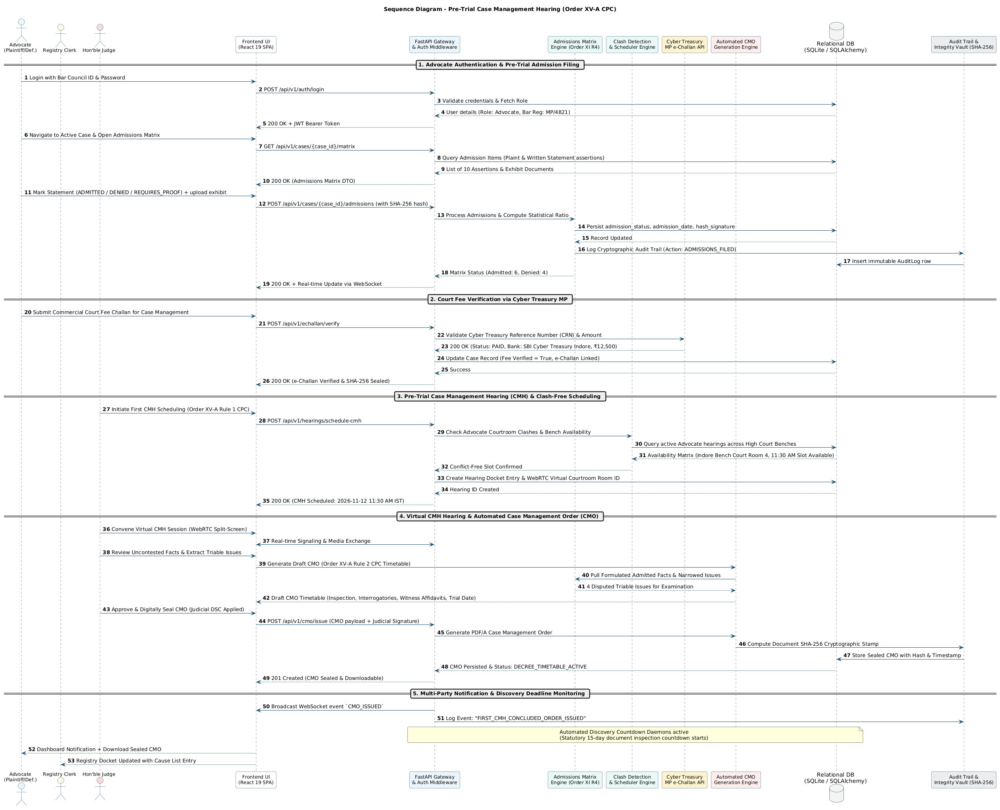
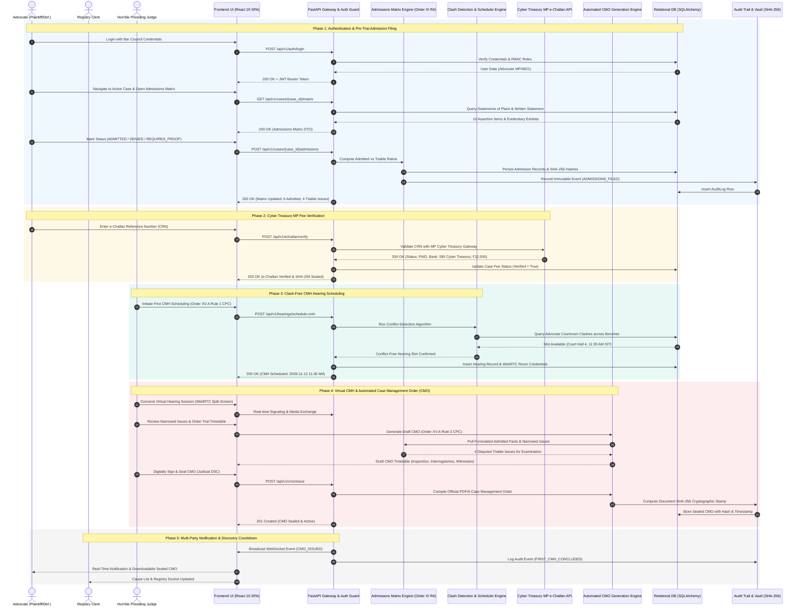

# Sequence Diagram: Pre-Trial Case Management Hearing (Order XV-A CPC)

**Academic Framework:** Major Project (BTCS706N) - Semester VII  
**Institution:** Shri Vaishnav Vidyapeeth Vishwavidyalaya, Indore  
**Department:** Computer Science and Engineering  
**Team ID:** SVVV-CSE-2026-MP-14  
**Project Guide:** Prof. Shweta Pandey  

---

## 🖼️ Print-Ready Diagram Image

> [!TIP]
> **High-Resolution Vector SVG**: [Download Sequence_Diagram.svg](file:///Users/mukulbhamgare/Desktop/case-management-eportal/diagrams/Sequence_Diagram.svg)  
> **Print-Ready PNG Image**: [Download Sequence_Diagram.png](file:///Users/mukulbhamgare/Desktop/case-management-eportal/diagrams/Sequence_Diagram.png)  
> **Full Printable UML Book (HTML)**: [Open Printable_UML_Book.html](file:///Users/mukulbhamgare/Desktop/case-management-eportal/diagrams/Printable_UML_Book.html)

  

---

## 1. Visual Mermaid Sequence Diagram

---

## 2. Interaction Overview & Statutory CPC Compliance

This Sequence Diagram captures the dynamic lifecycle interaction of the **Commercial Court Case Management e-Portal** pursuant to the statutory provisions of **Order XV-A and Order XI of the Code of Civil Procedure (CPC), 1908**, as amended by the **Commercial Courts Act, 2015**:

1. **Phase 1: Pre-Trial Admission & Denial (Order XI Rule 4 CPC)**
   - Advocates access the automated Admissions & Denials Matrix to record responses to opposing assertions before the first Case Management Hearing.
   - The system prevents frivolous denials by requiring documentary proof references, and cryptographically signs each entry.

2. **Phase 2: Commercial Court Fee Verification (MP Cyber Treasury)**
   - Integrates with the Madhya Pradesh Cyber Treasury system via secure REST APIs to verify e-Challan payments in real-time, preventing registry delays.

3. **Phase 3: Clash-Free Hearing Scheduling (Order XV-A Rule 1 CPC)**
   - The scheduling engine checks cross-bench calendars (Jabalpur, Indore, Gwalior) to eliminate advocate scheduling conflicts before locking hearing slots.

4. **Phase 4: Virtual Hearing & Automated CMO Issuance (Order XV-A Rule 2 CPC)**
   - The Presiding Judge reviews admitted facts versus triable issues during the WebRTC virtual hearing.
   - The Automated CMO Engine instantly generates the legally binding Case Management Order setting strict discovery and witness examination deadlines.

5. **Phase 5: Discovery Countdown & Tamper-Proof Audit Trail**
   - Active discovery countdown daemons track compliance with the statutory 15-day document inspection limit.
   - All state transitions are logged with SHA-256 cryptographic hashes for full judicial auditability.
