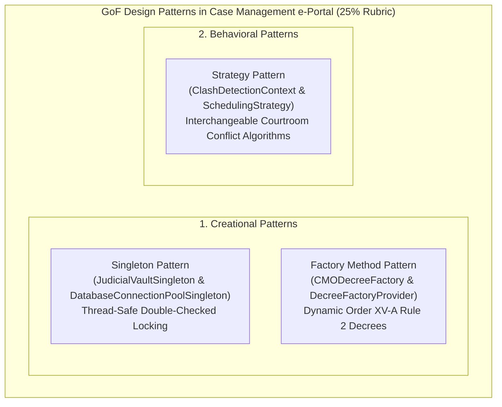
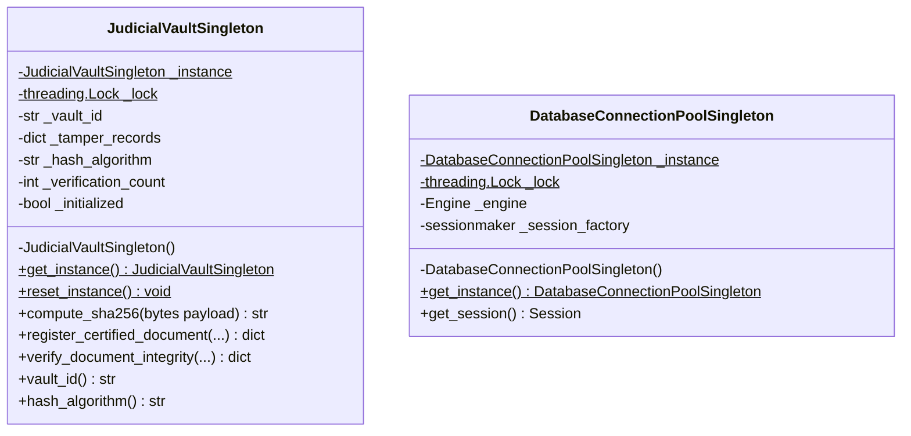
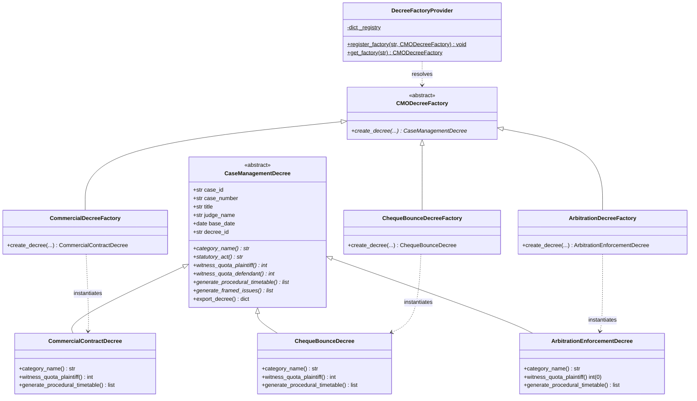
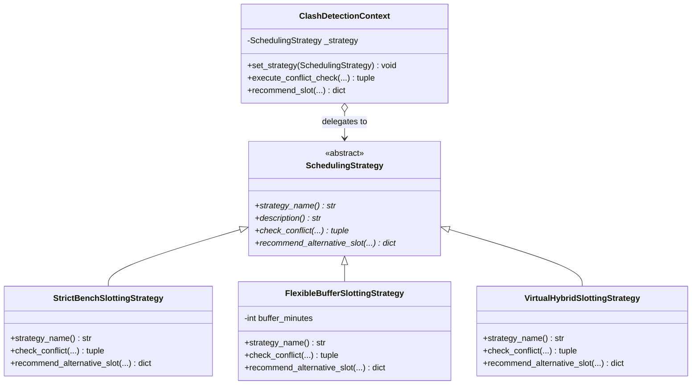

# Gang of Four (GoF) Design Patterns Specification

**Academic Framework:** Major Project (BTCS706N) - Semester VII  
**Coursework Category:** Object-Oriented Implementation & Design Patterns (**Rubric Weightage: 25% / 50 Marks**)  
**Institution:** Shri Vaishnav Vidyapeeth Vishwavidyalaya, Indore  
**Department:** Computer Science and Engineering  
**Team ID:** `SVVV-CSE-2026-MP-14`  
**Project Guide:** Prof. Shweta Pandey  

---

## 1. Executive Summary & Architectural Motivation

In compliance with the **SVVV B.Tech CSE Semester-VII Major Project Syllabus (BTCS706N — Phase 3 & 4)**, the Case Management Hearing e-Portal implements formal **Gang of Four (GoF)** software design patterns. These patterns solve real-world judicial software challenges governed by the **Commercial Courts Act, 2015** and **Order XV-A of the Code of Civil Procedure (CPC), 1908**:

---

## 2. Pattern 1: Creational — Singleton Pattern

### 2.1 Problem Statement
1. **Cryptographic Tamper-Proofing**: Order XV-A decrees, plaints, and admissions require cryptographic digital hashing (SHA-256). Spawning multiple uncoordinated vault instances causes race conditions, duplicate logs, and inconsistent ledger verification states.
2. **Database Connection Leaks**: Under high-concurrency ASGI asynchronous workers (Uvicorn), unmanaged connection allocation leads to database lockouts and connection pool exhaustion.

### 2.2 Solution: Thread-Safe Double-Checked Locking Singleton
The platform implements `JudicialVaultSingleton` and `DatabaseConnectionPoolSingleton` using **Double-Checked Locking** with `threading.Lock`. Even under heavy concurrent multi-threaded requests, exactly one instance is guaranteed.

### 2.3 Mermaid UML Class Diagram

### 2.4 Code Reference
* **Implementation File**: `backend/app/patterns/singleton.py`
* **Test Verification**: `backend/tests/test_patterns.py::test_judicial_vault_singleton_identity` (Validates `v1 is v2 is v3` and 30 concurrent threads).
* **Live Interactive API Endpoint**: `GET /api/v1/patterns/singleton/vault-status`

---

## 3. Pattern 2: Creational — Factory Method / Abstract Factory Pattern

### 3.1 Problem Statement
Under **Order XV-A Rule 2 CPC**, different types of commercial disputes demand distinct statutory discovery timetables, witness quotas, and dispute issues:
- **Commercial Contracts (Sec 2(1)(c)(i))**: Requires strict 15-day inspection, interrogatories, and a witness quota of 3 per side.
- **Cheque Bounce (Sec 138 NI Act)**: Fast-track summary timetable with restricted cross-examination.
- **Arbitration Enforcement (Sec 34)**: Zero oral witness examination (purely record-based oral arguments).
- **Summary Suits (Order XXXVII)**: Liquidated demand pre-trial timetable.

Hardcoding `if/elif` statements across route controllers violates the **Open/Closed Principle (OCP)**.

### 3.2 Solution: Factory Method & Dynamic Provider Registry
`CaseManagementDecree` defines the abstract product contract, while concrete factories inherit from `CMODecreeFactory`. The `DecreeFactoryProvider` acts as a dynamic registry, instantiating the appropriate statutory decree at runtime.

### 3.3 Mermaid UML Class Diagram

### 3.4 Code Reference
* **Implementation File**: `backend/app/patterns/factory.py`
* **Test Verification**: `backend/tests/test_patterns.py::test_decree_factory_provider_dynamic_resolution`
* **Live Interactive API Endpoint**: `POST /api/v1/patterns/factory/cmo-preview`

---

## 4. Pattern 3: Behavioral — Strategy Pattern

### 4.1 Problem Statement
Courtroom listing algorithms must support varying procedural rules depending on the hearing context:
1. **Physical Courtrooms across High Court Benches**: Strict zero-tolerance collision detection across Jabalpur, Indore, and Gwalior benches.
2. **Inter-Court Transit**: Advocates appearing in Court Hall 1 cannot appear in Court Hall 4 five minutes later without a realistic physical transit buffer.
3. **Virtual Courtrooms (WebRTC / Video Conferencing)**: Physical travel buffer is unnecessary, but simultaneous virtual sessions must be blocked.

Tying listing code to a single hardcoded algorithm prevents court registry flexibility.

### 4.2 Solution: Strategy Pattern with Dynamic Context
The `SchedulingStrategy` interface defines collision detection and slot recommendation contracts. `ClashDetectionContext` maintains a reference to the active strategy and allows runtime hot-swapping without modifying client code.

### 4.3 Mermaid UML Class Diagram

### 4.4 Code Reference
* **Implementation File**: `backend/app/patterns/strategy.py`
* **Test Verification**: `backend/tests/test_patterns.py::test_clash_detection_context_runtime_swapping`
* **Live Interactive API Endpoint**: `POST /api/v1/patterns/strategy/simulate-clash`

---

## 5. Viva Voce External Examiner Q&A Guide (Design Patterns)

### Q1: Why did you use the Singleton pattern for the Judicial Vault?
> **Answer:** Under Section 65B of the Indian Evidence Act and Order XV-A CPC, judicial dockets must maintain an unbroken chain of custody. A Singleton guarantees that all digital signatures and SHA-256 seals pass through one centralized, thread-safe instance with double-checked locking, avoiding race conditions in multi-threaded ASGI environments.

### Q2: What is the difference between the Factory Method and Abstract Factory patterns in your CMO engine?
> **Answer:** We used the **Factory Method** pattern where `CMODecreeFactory` defines the abstract method `create_decree()`, and specialized creators (`CommercialDecreeFactory`, `ArbitrationDecreeFactory`) instantiate category-specific decrees. `DecreeFactoryProvider` acts as the registry dispatcher, keeping the system compliant with the Open/Closed Principle.

### Q3: How does the Strategy pattern assist in court clash detection?
> **Answer:** In commercial courts, hearing rules vary between in-person physical appearances (requiring transit buffers) and virtual WebRTC hearings. The Strategy pattern encapsulates each scheduling algorithm into separate classes (`StrictBenchSlottingStrategy`, `FlexibleBufferSlottingStrategy`, `VirtualHybridSlottingStrategy`), allowing the registry to switch strategies at runtime via `ClashDetectionContext`.

### Q4: How are these design patterns tested?
> **Answer:** We maintain 20+ automated unit tests in `backend/tests/test_patterns.py` verifying thread-safety, memory pointer invariance (`id(v1) == id(v2)`), polymorphic factory dispatch, and runtime strategy swapping. All tests execute in our automated GitHub Actions CI/CD pipeline.
