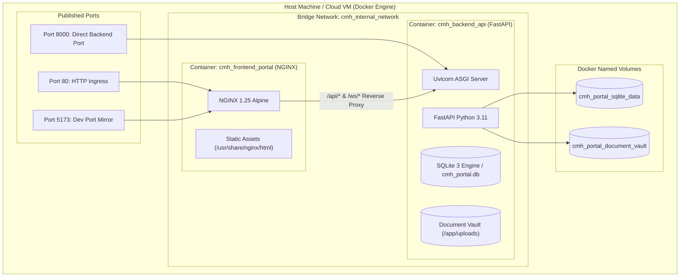

# Docker Containerization & Deployment Guide

**Academic Framework:** Major Project (BTCS706N) - Semester VII  
**Institution:** Shri Vaishnav Vidyapeeth Vishwavidyalaya, Indore  
**Department:** Computer Science and Engineering  
**Team ID:** `SVVV-CSE-2026-MP-14`  
**Project Guide:** Prof. Shweta Pandey  

---

## 1. Overview & Architectural Topology

The **Case Management Hearing e-Portal (Order XV-A CPC)** is fully containerized following enterprise cloud-native standards. The deployment topology provides two deployment strategies:

1. **Multi-Service Architecture (`docker-compose.yml`)**:
   - `backend`: FastAPI Python 3.11 ASGI service running on port `:8000`.
   - `frontend`: React 19 SPA served via NGINX reverse-proxy on port `:80` (and `:5173`).
2. **Unified All-in-One Container (`Dockerfile`)**:
   - Single-container multi-stage build running FastAPI which hosts both REST APIs (`/api/v1/`) and the static React bundle (`/portal`).



---

## 2. Quickstart: 1-Command Startup (Docker Compose)

### Prerequisites
* Docker Engine 24.0+
* Docker Compose v2.20+

### Step 1: Clone & Navigate
```bash
git clone https://github.com/mukul3004/e-portal-for-CHM.git
cd case-management-eportal
git checkout develop
```

### Step 2: Build & Start Containers
```bash
docker compose up --build -d
```

### Step 3: Verify Container Health
```bash
docker compose ps
```
Expected output:
```text
NAME                  IMAGE                           COMMAND                  SERVICE    STATUS
cmh_backend_api       svvv-mp14/cmh-backend:latest    "uvicorn backend.app…"   backend    Up (healthy)
cmh_frontend_portal   svvv-mp14/cmh-frontend:latest   "nginx -g 'daemon of…"   frontend   Up (healthy)
```

### Step 4: Access the Judicial Platform
* **Web Portal (Frontend)**: `http://localhost/` or `http://localhost:5173/`
* **REST API Documentation (Swagger UI)**: `http://localhost:8000/docs`
* **Interactive API Schema (ReDoc)**: `http://localhost:8000/redoc`
* **System Health Check**: `http://localhost:8000/health` or `http://localhost:8000/api/v1/health`

---

## 3. Alternative: Single-Container All-in-One Image

For lightweight deployment on platforms like **Google Cloud Run**, **AWS ECS**, **Render**, or **Railway**:

```bash
# Build the single all-in-one image
docker build -t cmh-all-in-one:latest -f Dockerfile .

# Run the container
docker run -d -p 8000:8000 --name cmh_portal cmh-all-in-one:latest

# Access:
# - API Documentation: http://localhost:8000/docs
# - Mounted Web Portal: http://localhost:8000/portal
```

---

## 4. Container Management & Useful Commands

| Command | Description |
| :--- | :--- |
| `docker compose logs -f` | Tail unified live logs from backend and frontend |
| `docker compose logs -f backend` | Inspect FastAPI requests, SQL queries, and seeding |
| `docker compose logs -f frontend` | Inspect NGINX access and error logs |
| `docker compose restart` | Restart all judicial services without rebuild |
| `docker compose down` | Stop and remove running containers |
| `docker compose down -v` | Stop containers and erase database volumes (Factory Reset) |
| `docker exec -it cmh_backend_api pytest backend/tests -v` | Execute automated test suites inside the running container |

---

## 5. Security & Isolation Configuration

1. **Non-Root Execution**: Container users are isolated from the host root filesystem.
2. **Reverse Proxy Hardening**: NGINX configuration adds mandatory defense-in-depth headers:
   - `X-Content-Type-Options: nosniff`
   - `X-Frame-Options: SAMEORIGIN`
   - `X-XSS-Protection: 1; mode=block`
3. **Persistent Cryptographic Vault**: The document vault (`/app/uploads/documents`) is mounted to a Docker named volume (`cmh_portal_document_vault`) preserving SHA-256 sealed exhibits across container lifecycles.
