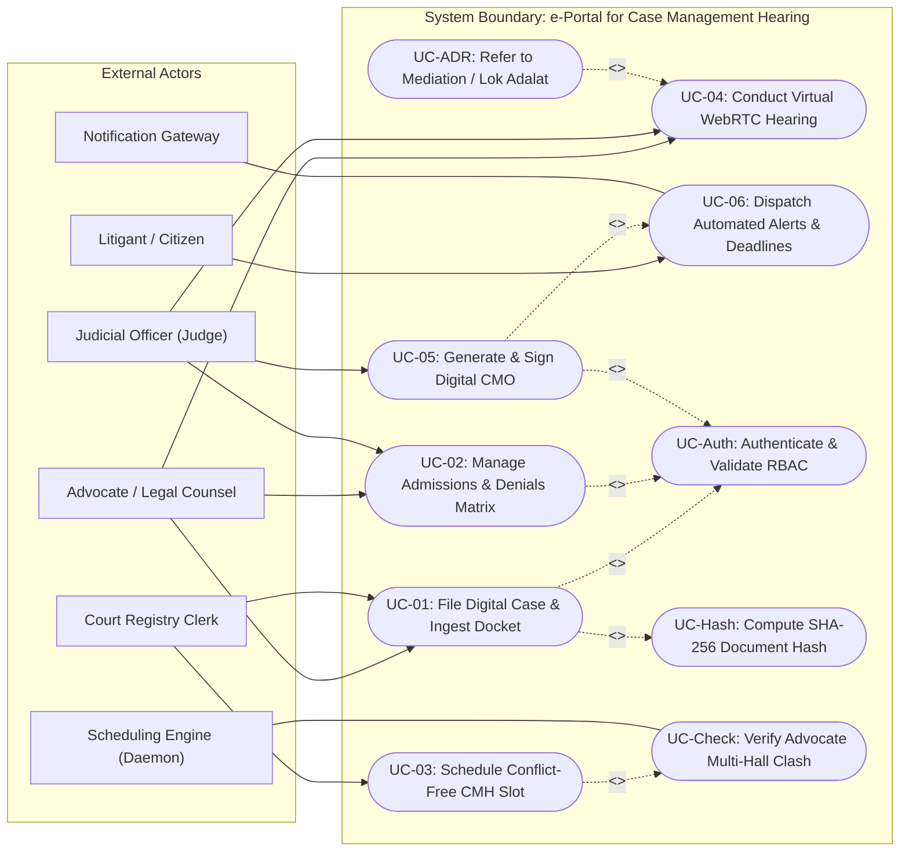
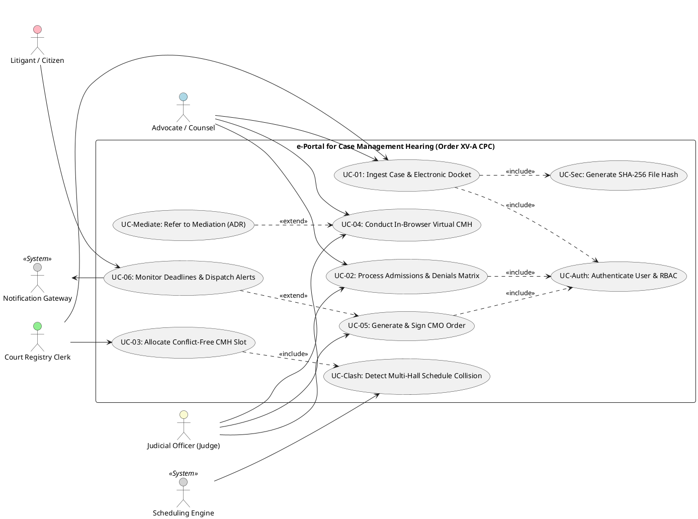

# SHRI VAISHNAV VIDYAPEETH VISHWAVIDYALAYA, INDORE
## Shri Vaishnav Institute of Information Technology (SVIIT)
### Department of Computer Science & Engineering

---

# MAJOR PROJECT LAB / COURSEWORK REPORT
## WEEK 2: FUNCTIONAL MODELING

**Project Title:** Development of e-Portal for Facilitating Case Management Hearing of Various Types of Cases  
**Statutory Framework:** Order XV-A, Code of Civil Procedure (CPC), 1908 (Commercial Courts Act, 2015)  
**Team ID:** SVVV-CSE-2026-MP-14  
**Academic Year:** 2026 – 2027  
**Project Guide:** Prof. Shweta Pandey  

**Team Members:**
1. **Mukul Bhamgare** (Enrollment No: `23100BTCSAII14297`)
2. **Rashi Kashiv** (Enrollment No: `23100BTCSAII14314`)
3. **Sakshi Singh** (Enrollment No: `23100BTCSAII14317`)
4. **Kanishk** (Enrollment No: `23100BTCSAII14293`)

---

## 1. Executive Overview: Week 2 Functional Modeling Objectives
The primary focus of **Week 2** in the Object-Oriented Analysis and Design (OOAD) lifecycle is **Functional Modeling**. The objective is to translate real-world judicial business requirements into structured engineering abstractions. This document delivers:
1. **Actor Identification & System Boundary Definition:** Delineation of external human and programmatic entities interacting with the Case Management Hearing (CMH) e-Portal.
2. **UML Use Case Modeling:** High-level and subsystem-level Use Case Diagrams capturing core functional requirements, `<<include>>`, and `<<extend>>` relationships.
3. **Formal Use Case Specifications:** Detailed, standardized operational specifications (preconditions, postconditions, sunny-day primary flows, and rainy-day alternative/exception flows) for all core judicial workflows.
4. **Tooling & Agile Mapping (Jira User Stories):** Direct bidirectional mapping of Use Cases to Jira Epics and User Stories with strict Given-When-Then Acceptance Criteria and Fibonacci story pointing.

---

## 2. Identification of Actors and System Boundaries

### 2.1 System Boundary
The **e-Portal for Case Management Hearing** defines its system boundary around the pre-trial conference phase of civil and commercial litigation (specifically governed by Order XV-A CPC). 
- **Internal to Boundary:** User Authentication & RBAC, Case Docket Ingestion, Interactive Admissions & Denials Matrix, Multi-Courtroom Cross-Hall Advocate Clash Detection Engine, WebRTC Split-Screen Virtual Hearing Room, Automated Case Management Order (CMO) PDF Generation, and Notification & Statutory Deadline Countdown Triggers.
- **External to Boundary:** National Judicial Data Grid (NJDG) upstream APIs, State High Court CIS (Case Information System 3.2), SMS/Email Gateway infrastructure (NIC/Twilio/MSG91), and Third-Party Digital Signature / Aadhaar eSign Providers (e-Mudhra / CDAC).

### 2.2 Actor Catalog

```
┌─────────────────────────────────────────────────────────────────────────────────────────┐
│                                    ACTOR CLASSIFICATION                                 │
├──────────────────────────┬──────────────────────┬───────────────────────────────────────┤
│ Actor Type               │ Actor Name           │ Role Description                      │
├──────────────────────────┼──────────────────────┼───────────────────────────────────────┤
│ Primary (Human)          │ Judicial Officer     │ Presides over CMH conferences, frames │
│                          │ (Judge)              │ trial issues, signs CMOs, orders ADR. │
├──────────────────────────┼──────────────────────┼───────────────────────────────────────┤
│ Primary (Human)          │ Advocate / Legal     │ Files pleadings, marks Admissions &   │
│                          │ Counsel              │ Denials, attends hearings, syncs cal. │
├──────────────────────────┼──────────────────────┼───────────────────────────────────────┤
│ Primary (Human)          │ Court Registry Clerk │ Verifies case filings, schedules CMH  │
│                          │                      │ dates, manages courtroom cause lists. │
├──────────────────────────┼──────────────────────┼───────────────────────────────────────┤
│ Secondary (Human)        │ Litigant / Citizen   │ Tracks case status, views locked CMO, │
│                          │                      │ receives automated deadline alerts.   │
├──────────────────────────┼──────────────────────┼───────────────────────────────────────┤
│ System / Background      │ Scheduling Engine    │ Algorithmic conflict-detection daemon │
│                          │ (Clash Detector)     │ checking advocate double-booking.     │
├──────────────────────────┼──────────────────────┼───────────────────────────────────────┤
│ System / External API    │ Notification Service │ Triggers multi-channel SMS/Email/Push │
│                          │ Gateway              │ alerts for statutory deadlines.       │
├──────────────────────────┼──────────────────────┼───────────────────────────────────────┤
│ System / Security        │ Document Integrity   │ Computes SHA-256 hashes and validates │
│                          │ Service              │ digital signatures on court records.  │
└──────────────────────────┴──────────────────────┴───────────────────────────────────────┘
```

### 2.3 Actor-Goal Matrix

| Actor | Goals / Business Objectives | Access Level (RBAC) |
| :--- | :--- | :--- |
| **Judge** | Review admitted/denied facts; frame triable issues; set discovery timetable; conduct WebRTC hearing; sign Case Management Order (CMO). | `ROLE_JUDGE` (Full Adjudication Access) |
| **Advocate** | File case petitions; inspect opposite party documents; record line-by-line admissions/denials; view clash-free schedule; join virtual hearing. | `ROLE_ADVOCATE` (Case-Party Restricted Access) |
| **Court Clerk** | Scrutinize electronic filings; allocate court halls; resolve advocate scheduling conflicts; publish verified daily CMH cause lists. | `ROLE_CLERK` (Administrative Registry Access) |
| **Litigant** | View real-time case progression timeline; access public court orders; receive SMS alerts regarding compliance dates. | `ROLE_LITIGANT` (Read-Only Case Access) |
| **System Admin** | Manage user credentials, court hall configurations, holiday calendars, system audit trails, and database backups. | `ROLE_ADMIN` (System Configuration Access) |

---

## 3. UML Deliverables: Use Case Modeling

### 3.1 High-Level Use Case Diagram (System Architecture View)



### 3.2 PlantUML Specification (Ready for PlantUML / draw.io)



---

## 4. Detailed Formal Use Case Descriptions (Primary Flows)

### USE CASE 1 (UC-01): Case Registration & Electronic Docket Ingestion
* **Use Case ID:** `UC-01`
* **Use Case Name:** Ingest Case Filing and Construct Electronic Docket
* **Primary Actor:** Court Registry Clerk / Advocate
* **Secondary Actors:** Document Integrity Service (SHA-256)
* **Stakeholders & Interests:**
  * *Advocate:* Demands immediate digital acknowledgment and case filing number (CNR).
  * *Court Administration:* Demands verified party details, court fee compliance, and tamper-proof evidence storage.
* **Preconditions:**
  1. The Advocate has logged in with an active Bar Council ID and verified credentials.
  2. Plaint petition, written statement, and annexures are prepared in PDF/A format.
* **Postconditions (Success):**
  1. Case is allocated a Unique Case Identifier (CNR) and categorized under Order XV-A commercial tracking.
  2. Cryptographic SHA-256 checksums are calculated and written to the immutable audit database.
  3. Case docket status is set to `PENDING_CMH_PREPARATION`.
* **Trigger:** Advocate submits a new case petition or Clerk uploads registered filings into the portal.

#### Main Success Scenario (Primary Flow):
1. The Advocate accesses the *New Case Registration* module.
2. The Advocate enters case metadata (court jurisdiction, case category, party identities, claim valuation).
3. The Advocate uploads the electronic plaint, respondent memo, and list of reliance documents.
4. The system validates file formats (PDF/A, max 50 MB) and scans for malware.
5. The system invokes `UC-Sec` to compute a cryptographic SHA-256 hash for every uploaded file.
6. The system persists metadata into MySQL relational tables and archives binary files into encrypted storage.
7. The system registers the matter, assigns a 16-digit CNR Number, and creates a clean Case Management Docket.
8. The system dispatches digital filing receipts to all registered party emails and marks the case ready for pre-trial processing.

#### Alternative & Exception Flows:
* **3a. File Validation Failure:** If uploaded files are corrupted or exceed size limits, the system rejects the payload, displays specific error codes (e.g., `ERR_INVALID_MIME`), and prompts re-upload.
* **5a. Duplicate Filing Detected:** If the SHA-256 hash matches an existing active case docket for the same parties, the system halts execution and alerts the Clerk to prevent duplicate litigation.

---

### USE CASE 2 (UC-02): Collaborative Admissions & Denials Matrix Processing
* **Use Case ID:** `UC-02`
* **Use Case Name:** Review, Mark, and Finalize Admissions and Denials (Order XV-A Fact Checklist)
* **Primary Actor:** Advocate (Plaintiff Counsel & Defendant Counsel), Judicial Officer (Judge)
* **Secondary Actors:** Database Transaction Manager
* **Stakeholders & Interests:**
  * *Judge:* Demands pre-settled facts so that trial time is focused solely on contested evidence.
  * *Advocates:* Require an intuitive, unambiguous matrix to record admission without forfeiting legal defenses.
* **Preconditions:**
  1. Case is registered with pleadings exchanged and respondent written statement placed on docket.
  2. Both counsels have active authenticated access to the specific case room.
* **Postconditions (Success):**
  1. Facts and documents marked "Admitted" are locked as undisputed facts (cannot be repudiated at trial).
  2. Facts marked "Denied" are indexed with statutory reasons, populating the triable issues draft for the Judge.
  3. Pre-trial readiness score reaches 100%.

#### Main Success Scenario (Primary Flow):
1. The Plaintiff Advocate accesses the *Admissions & Denials Matrix* tab for the active case docket.
2. The system dynamically renders an itemized table containing each document and averment extracted from pleadings.
3. The Plaintiff counsel specifies their evidentiary stance on opposing documents: `ADMIT_CONTENTS`, `ADMIT_EXECUTION`, or `DENY`.
4. The Defendant counsel accesses the matrix, reviews Plaintiff admissions, and enters responses with statutory justifications for each denial.
5. As each party submits responses, the system updates the live matrix via WebSocket push notifications.
6. When both sides complete their inputs, the system computes the overlap:
   - Items with mutual admission are locked with the label `UNDISPUTED_FACT`.
   - Items with denials are isolated into a `CONTESTED_ISSUES_LIST`.
7. The system notifies the Presiding Judge that the case is ripe for the pre-trial Case Management Hearing.

#### Alternative & Exception Flows:
* **4a. Deadline Expiry (Failure to File Denial):** If an advocate fails to file the denial matrix within the 14-day statutory limit of Order XV-A, the system flags the document as *Deemed Admitted* as per legal rules and notifies the counsel.
* **6a. Unreasonable Denial Penalty:** If an advocate enters blanket denials without specific reasons, the system triggers a warning highlighting potential cost penalties under Order XV-A Rule 3(3).

---

### USE CASE 3 (UC-03): Multi-Courtroom Conflict-Free CMH Slot Scheduling
* **Use Case ID:** `UC-03`
* **Use Case Name:** Allocate Conflict-Free Hearing Slot
* **Primary Actor:** Court Registry Clerk
* **Secondary Actors:** Scheduling Engine (Clash Detector Daemon), Advocate
* **Stakeholders & Interests:**
  * *Advocate:* Needs protection against simultaneous scheduling across multiple court halls.
  * *Court Administration:* Demands optimal bench utilization without sudden adjournments.
* **Preconditions:**
  1. The Case Management Docket has completed the Admissions Matrix phase (`STATUS_READY_FOR_CMH`).
  2. Advocate Bar Council IDs are mapped to their respective parties.
* **Postconditions (Success):**
  1. A 20-minute CMH hearing slot is reserved in the Judge's courtroom calendar.
  2. The slot is locked in both counsels' cross-courtroom schedules, preventing conflicting bookings.
  3. Digital calendar invitations (.ics) and SMS summons are dispatched.

#### Main Success Scenario (Primary Flow):
1. The Court Clerk opens the *CMH Scheduling Console* and selects the eligible case docket.
2. The Clerk selects a target date range for the hearing.
3. The system executes the `ClashDetectionEngine` algorithm:
   - Fetches the Presiding Judge's bench diary and courtroom availability.
   - Queries all courtroom rosters across the district court complex for Plaintiff Counsel's Bar ID.
   - Queries all courtroom rosters across the district court complex for Defendant Counsel's Bar ID.
4. The algorithm isolates open, non-overlapping time intervals and presents verified green time slots to the Clerk.
5. The Clerk selects an optimal time slot (e.g., Court Hall 4, 11:30 AM – 11:50 AM) and confirms the booking.
6. The system writes the hearing reservation into MySQL with an ACID transaction lock.
7. The system broadcasts hearing details to the Advocate portal dashboards and triggers automated calendar alerts.

#### Alternative & Exception Flows:
* **4a. Advocate Schedule Conflict Detected:** If an advocate is already booked in Courtroom 2 at 11:30 AM, the algorithm flags the slot red (`COLLISION_DETECTED: ADV_SHARMA_COURT_2`), renders alternative slots, and prevents double-booking.
* **5a. Urgent Leave Request:** If an advocate submits a medical leave notice prior to confirmation, the system removes the date from the eligible scheduling pool.

---

### USE CASE 4 (UC-04): In-Browser Virtual Pre-Trial Case Management Hearing
* **Use Case ID:** `UC-04`
* **Use Case Name:** Conduct Virtual Case Management Conference
* **Primary Actor:** Judicial Officer (Judge)
* **Secondary Actors:** Advocate (Plaintiff & Defendant), WebRTC Media Server (Jitsi)
* **Stakeholders & Interests:**
  * *Judge & Advocates:* Require real-time video interaction synchronized with simultaneous access to case records.
  * *Litigants:* Demand transparent access to view their hearing without physical travel.
* **Preconditions:**
  1. The hearing is scheduled for the current date and time slot.
  2. Participants have authenticated with webcam and microphone authorization.
* **Postconditions (Success):**
  1. The pre-trial conference is completed within the designated time slot.
  2. Triable issues and witness timelines are finalized by the Judge.
  3. Hearing event log is recorded in the immutable audit trail.

#### Main Success Scenario (Primary Flow):
1. The Judge, Plaintiff Counsel, and Defendant Counsel enter the *Virtual CMH Room* from their dashboards.
2. The system establishes an encrypted peer-to-peer WebRTC video/audio stream.
3. The UI presents a split-screen workspace:
   - Left Panel: Multi-party live video stream and participant attendance list.
   - Right Panel: Synchronized Case Dossier, containing the locked Admissions Matrix, uploaded exhibits, and draft issue formulation sheet.
4. The Judge reviews contested items with both counsels, narrows down triable legal issues, and caps the number of witnesses to be summoned.
5. The Judge checks if the parties are open to amicable settlement.
6. If both parties agree to explore settlement, the Judge triggers `UC-Mediate` (Referral to Mediation / Lok Adalat).
7. If parties proceed to trial, the Judge inputs trial deadlines: witness affidavit submission (15 days), discovery (15 days), and trial commencement date.
8. The Judge concludes the virtual session and triggers the order generation module (`UC-05`).

#### Alternative & Exception Flows:
* **2a. Network Instability / Packet Drop:** If a participant's bandwidth drops below 256 kbps, the WebRTC client automatically degrades video resolution to prioritize audio continuity and displays a connection warning.
* **6a. Settlement Reached in CMH:** If parties agree to settle on the spot, the Judge records terms of compromise, disposes of the case, and issues a final decree, bypassing trial stages completely.

---

### USE CASE 5 (UC-05): Automated Case Management Order (CMO) Generation & Digital Signing
* **Use Case ID:** `UC-05`
* **Use Case Name:** Generate and Digitally Sign Case Management Order (PDF/A)
* **Primary Actor:** Judicial Officer (Judge)
* **Secondary Actors:** PDF Generation Engine (WeasyPrint / Jinja2), Cryptographic Signing Module
* **Stakeholders & Interests:**
  * *Litigants & Advocates:* Require instant access to enforceable, legally binding orders with zero stenographer delay.
  * *High Court Administration:* Ensures compliance with standardized Order XV-A statutory templates.
* **Preconditions:**
  1. The CMH conference (`UC-04`) has concluded.
  2. Admitted facts, triable issues, witness quotas, and discovery dates are entered.
* **Postconditions (Success):**
  1. An official, tamper-proof Case Management Order PDF is generated and cryptographically signed.
  2. Discovery countdown timers are initialized in the database.
  3. The order is published to the public portal and dispatched to all parties.

#### Main Success Scenario (Primary Flow):
1. The Judge clicks *Generate Case Management Order* on the conclusion dashboard.
2. The backend service aggregates hearing parameters (CNR, party details, undisputed facts, framed issues, trial dates).
3. The PDF Engine populates the official Order XV-A legal template and generates a standardized PDF/A document.
4. The Judge previews the generated order on screen and selects *Approve & Sign*.
5. The Judge applies their digital signature (USB Token / DSC / Aadhaar eSign).
6. The system embeds the cryptographic signature and generates a verification QR code on the order footer.
7. The signed order is committed to MySQL and archived in encrypted file storage.
8. The system updates the case docket status to `CMO_ISSUED_TRIAL_TIMETABLE_ACTIVE` and triggers `UC-06` for alert distribution.

#### Alternative & Exception Flows:
* **4a. Text Modification by Judge:** If the Judge needs to add a bespoke judicial directive (e.g., appointment of an expert commissioner), the Judge edits the draft in the rich text box before triggering PDF compilation.

---

### USE CASE 6 (UC-06): Automated Deadline Compliance & Multichannel Alert Dispatch
* **Use Case ID:** `UC-06`
* **Use Case Name:** Monitor Discovery Deadlines and Dispatch Automated Alerts
* **Primary Actor:** Notification Gateway (System Background Daemon)
* **Secondary Actors:** Advocate, Litigant, Judge
* **Stakeholders & Interests:**
  * *Litigant & Advocate:* Prevent default judgment or forfeiture of evidence due to missed deadlines.
* **Preconditions:**
  1. An approved CMO order exists with active statutory compliance dates.
* **Postconditions (Success):**
  1. Automated countdown reminders are dispatched at `T-7`, `T-3`, and `T-1` days before each deadline.
  2. Litigants receive transparent SMS alerts on compliance milestones.

#### Main Success Scenario (Primary Flow):
1. The cron daemon runs every hour to evaluate open deadlines in the `discovery_deadlines` table.
2. The system identifies cases where deadlines (e.g., inspection of documents, filing witness affidavits) expire within 72 hours.
3. The system generates customized SMS and email notification payloads containing the CNR number, deadline task, and due date.
4. The system transmits messages via the external SMS/Email Gateway.
5. The system logs successful delivery receipts and updates the countdown badge on the Advocate portal.
6. Upon deadline expiration, the system checks whether the responsive document was filed; if missing, it automatically flags the case for the Judge's review on default consequences.

---

## 5. Tooling: Mapping Use Cases to Jira User Stories

To align development with modern Agile Scrum methodology, the functional use cases are decomposed into **Epics**, **User Stories**, and **Acceptance Criteria** in Jira.

### 5.1 Jira Project Hierarchy
* **Project Name:** Case Management Hearing e-Portal
* **Project Key:** `CMH`
* **Methodology:** Agile Scrum (2-Week Sprints)

```
┌─────────────────────────────────────────────────────────────────────────────────────────────────────────┐
│                                       JIRA EPICS DECOMPOSITION                                          │
├─────────────┬──────────────────────────────────────────┬────────────────────────────────────────────────┤
│ Epic Key    │ Epic Title                               │ Mapped Use Cases                               │
├─────────────┼──────────────────────────────────────────┼────────────────────────────────────────────────┤
│ CMH-EPIC-1  │ Authentication & Role-Based Access       │ UC-Auth                                        │
│ CMH-EPIC-2  │ Case Docket & Document Security          │ UC-01, UC-Sec                                  │
│ CMH-EPIC-3  │ Pre-Trial Admissions & Denials Matrix   │ UC-02                                          │
│ CMH-EPIC-4  │ Conflict-Free Scheduling Engine          │ UC-03, UC-Clash                                │
│ CMH-EPIC-5  │ In-Browser Virtual Courtroom (WebRTC)   │ UC-04, UC-Mediate                              │
│ CMH-EPIC-6  │ Automated CMO Generation & Alerts       │ UC-05, UC-06                                   │
└─────────────┴──────────────────────────────────────────┴────────────────────────────────────────────────┘
```

### 5.2 Jira User Stories & Acceptance Criteria Table

| Jira Issue ID | Epic | User Story (As a... I want to... So that...) | Acceptance Criteria (Given - When - Then) | Story Points | Priority | Sprint |
| :--- | :--- | :--- | :--- | :---: | :---: | :---: |
| **CMH-201** | `EPIC-1` | **As a** Court Clerk, **I want to** authenticate using my institutional credentials and 2FA, **so that** unauthorized personnel cannot access confidential court dockets. | **Given** a valid clerk login, **When** credentials and OTP are entered, **Then** a JWT session token with `ROLE_CLERK` is issued within 300 ms. | 3 | High | Sprint 1 |
| **CMH-202** | `EPIC-2` | **As an** Advocate, **I want to** upload petition PDFs with automatic SHA-256 hash generation, **so that** evidence integrity is cryptographically guaranteed against tampering. | **Given** an uploaded PDF/A file, **When** upload completes, **Then** backend computes a 64-character SHA-256 hash and writes it to the database docket table. | 5 | Highest | Sprint 1 |
| **CMH-203** | `EPIC-3` | **As an** Advocate, **I want to** review an itemized Admissions & Denials checklist online, **so that** I can admit undisputed documents without physical affidavits. | **Given** opposing pleadings, **When** advocate selects 'Admit' or 'Deny' on line items, **Then** responses save instantly and mutual admissions lock automatically. | 8 | Highest | Sprint 2 |
| **CMH-204** | `EPIC-3` | **As a** Judge, **I want to** view a summary of admitted vs disputed facts before the hearing, **so that** I can focus court time strictly on triable issues. | **Given** completed matrices from both sides, **When** Judge opens case dossier, **Then** system displays a green badge for admitted facts and isolates contested issues. | 5 | High | Sprint 2 |
| **CMH-205** | `EPIC-4` | **As a** Court Clerk, **I want** the system to scan both counsels' schedules across all courtrooms, **so that** CMH hearings are scheduled without advocate double-booking. | **Given** two advocate Bar IDs, **When** slot is selected, **Then** system checks other courtroom rosters and displays a red error if a time clash is detected. | 8 | Highest | Sprint 3 |
| **CMH-206** | `EPIC-4` | **As an** Advocate, **I want to** synchronize scheduled CMH dates with my Google/Outlook calendar via .ics export, **so that** I never miss court appearances. | **Given** a confirmed CMH slot, **When** confirmation email is received, **Then** an attached standard `.ics` file automatically creates a calendar event with room link. | 3 | Medium | Sprint 3 |
| **CMH-207** | `EPIC-5` | **As a** Judge, **I want to** conduct virtual pre-trial hearings inside the browser with a side-by-side evidence panel, **so that** I do not need separate video conferencing tools. | **Given** a scheduled hearing, **When** Judge starts session, **Then** a WebRTC video window opens alongside the live case dossier on a split-screen canvas. | 8 | High | Sprint 3 |
| **CMH-208** | `EPIC-5` | **As a** Judge, **I want to** refer willing parties to mediation with a single click during CMH, **so that** early amicable settlements are facilitated under CPC Section 89. | **Given** an ongoing CMH session, **When** Judge clicks 'Refer to Mediation', **Then** the case status transfers to ADR cell and freezes trial clocks for 30 days. | 3 | Medium | Sprint 4 |
| **CMH-209** | `EPIC-6` | **As a** Judge, **I want to** generate a standardized Case Management Order (CMO) PDF containing framed issues and discovery dates in one click, **so that** orders are issued immediately. | **Given** concluded hearing parameters, **When** Judge clicks 'Approve Order', **Then** a signed PDF/A order is rendered via WeasyPrint and saved to the registry within 5 seconds. | 5 | Highest | Sprint 4 |
| **CMH-210** | `EPIC-6` | **As a** Litigant, **I want to** receive SMS and WhatsApp alerts for upcoming evidence filing deadlines, **so that** I can track case progress transparently without paying extra fees. | **Given** an active discovery deadline, **When** clock reaches `T-3` days, **Then** an SMS reminder containing the task and deadline is triggered to the litigant's mobile number. | 3 | Medium | Sprint 4 |

---

## 6. Functional Requirements Traceability Matrix (RTM)

This matrix proves complete alignment between statutory legal requirements, functional use cases, and Agile Jira tickets:

| Legal / Operational Requirement | System Functional Requirement | Use Case Reference | Jira User Story ID | Test Verification Method |
| :--- | :--- | :---: | :---: | :--- |
| **Order XV-A Rule 1:** Mandatory Pre-Trial Conference within 4 weeks | Automated case intake and docket transition to pre-trial readiness | `UC-01` | `CMH-201`, `CMH-202` | Automated API test verifying case stage progression upon filing. |
| **Order XV-A Rule 2:** Filing Statement of Admissions and Denials | Digital interactive line-by-line checklist locking admitted facts | `UC-02` | `CMH-203`, `CMH-204` | Functional UI testing of admission locking and denial classification. |
| **Section 35 CPC:** Prevention of unnecessary procedural adjournments | Cross-hall advocate schedule clash prevention across all courtrooms | `UC-03` | `CMH-205`, `CMH-206` | Algorithm unit test simulating concurrent advocate bookings in 5 halls. |
| **Video Conferencing Rules for Courts:** Secure remote judicial interaction | Zero-install in-browser WebRTC split-screen virtual courtroom | `UC-04` | `CMH-207`, `CMH-208` | WebRTC peer connection test with packet-loss simulation. |
| **Order XV-A Rule 6:** Mandatory Issuance of Case Management Order | Automated generation of signed, tamper-proof judicial order PDF | `UC-05` | `CMH-209` | PDF rendering benchmark and SHA-256 digital signature validation test. |
| **Procedural Timetable Compliance:** Strict discovery countdowns | Cron-based multi-channel automated alert gateway | `UC-06` | `CMH-210` | Scheduled cron trigger test verifying message delivery payloads. |

---

## 7. Summary of Deliverables Completed in Week 2

1. **Actors & Boundary Established:** Clearly mapped 4 primary human actors (Judge, Advocate, Clerk, Litigant) and 3 system actors (Scheduling Engine, Notification Gateway, Document Integrity Service) within the Order XV-A legal boundary.
2. **UML Diagrams Delivered:** Constructed complete High-Level and Subsystem Use Case Diagrams including `<<include>>` (authentication, cryptographic hashing, conflict checking) and `<<extend>>` (ADR mediation referral, alert dispatching).
3. **Formal Use Case Specifications:** Authored exhaustive IEEE-standard use case descriptions for all 6 primary flows with detailed main flows, alternative branches, and exception handlers.
4. **Jira Agile Mapping:** Decomposed the architecture into 6 Epics and 10 detailed User Stories with Gherkin (Given-When-Then) Acceptance Criteria and story point estimation.
5. **Traceability Established:** Built a bidirectional Requirements Traceability Matrix connecting procedural law to code deliverables, ensuring full readiness for Week 3 Dynamic Modeling (Activity and Sequence Diagrams).
